# whatsapp-v2 — Native Android SIP Client

**Coral SIP Client** — a production-grade native Android SIP softphone. Audio and video
calling, multi-account SIP registration, Telecom integration, conferencing against
FreeSWITCH, and a chat tab on the Coral chat SDK.

| | |
|---|---|
| Version | **1.0.9** (`versionCode` 9), set in [`app/build.gradle.kts`](app/build.gradle.kts) |
| Application ID | `com.whatsappv2` |
| minSdk / targetSdk | 26 / 37 |

The name is the one the product ships under. It was briefly *Callisto*, then *CoralX*; the
application ID, the module names and the `com.whatsappv2` package keep their historical
spelling, because those are identifiers rather than names — changing the application ID
would orphan every installed copy. The reasoning is kept beside the string it governs, in
[`app/src/main/res/values/strings.xml`](app/src/main/res/values/strings.xml).

## Screenshots

Captured from the shipping **1.0.9** debug build on a **Samsung Galaxy M23 (SM-E236B),
Android 14**, driven over USB — real frames off a real handset, not mock-ups and not an
emulator. The account on screen is registered against a live FreeSWITCH, and the call
screens are one real call that rang, connected and carried audio.

**Server addresses are replaced with `sip.example.net` and `chat.example.com`.** The rule
that no hostname of ours reaches git (Task 32, §7) does not stop being true because the
host arrived as pixels instead of text — the CI guard only scans `*.properties` and
certificate extensions, so this one is kept by hand.

### Calls and the dialler

| Chats | Call history | Dialler | Dialler, number entered |
|---|---|---|---|
| 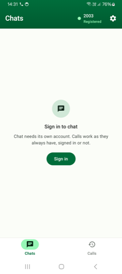 | 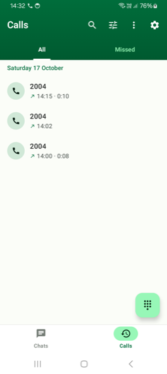 | 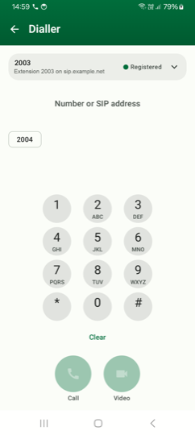 | 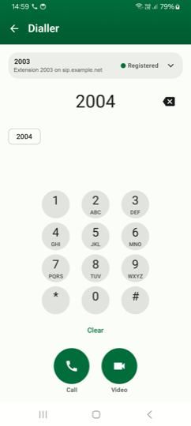 |

* **Chats** — one of the two bottom tabs. Signed out of chat here, and saying so rather
  than showing an empty list: *"Chat needs its own account. Calls work as they always have,
  signed in or not."* The app bar carries the registration state of the default SIP account
  (`2003`, **Registered**) right here on the chat tab — the thing most likely to be wrong
  about a softphone is not buried behind a menu.
* **Call history** — grouped by day, with direction, time and the connected duration
  (`14:15 · 0:10`). **All** and **Missed** filter it; the bar holds search, a filter sheet
  and an overflow with *Call recordings* and *Clear call history*. The dial-pad FAB is the
  only way in to the dialler — it stopped being a tab (see [`AppDestination`](app/src/main/kotlin/com/whatsappv2/ui/navigation/AppDestination.kt)).
* **Dialler** — the account selector sits above the keypad with its live registration
  state, because which account a call leaves on is a decision, not a setting. The field
  takes a **number or a full SIP address**. **Call** and **Video** are disabled until
  there is something to dial.
* **Dialler, number entered** — typing matches against history and offers `2004` as a
  chip. Both call buttons are now live.

### A call in progress

| Connecting | Connected | In-call keypad (DTMF) |
|---|---|---|
| 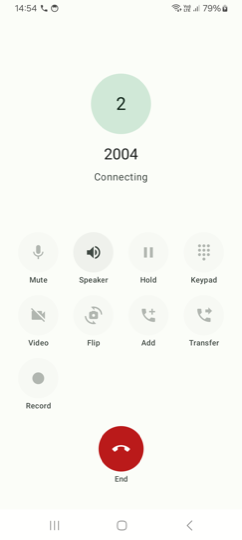 | 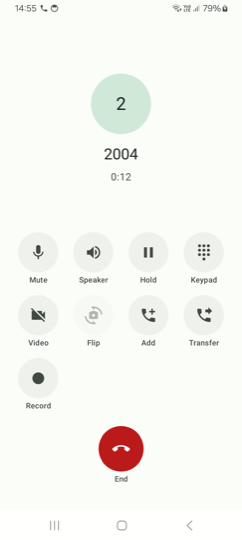 | 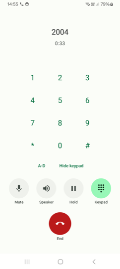 |

* **Connecting** — the state is spelled out (`Connecting`), and every control is greyed:
  nothing on this screen pretends to work before the call is up.
* **Connected** — the timer replaces the state, and the controls light up: **Mute**,
  **Speaker**, **Hold**, **Keypad**, **Video**, **Flip**, **Add**, **Transfer**,
  **Record**, and **End**. *Flip* stays disabled on an audio call — there is no camera to
  flip. **Add** builds a conference as a full mesh (everyone dials everyone); **Transfer**
  sends a REFER.
* **In-call keypad** — RFC 4733 digits in the media stream by default, with SIP INFO as a
  fallback for gateways that cannot (the choice is in Settings). `A`–`D` are there for the
  gateways that still want them, and the control row collapses to what still applies.

### Accounts

| SIP accounts | Account status |
|---|---|
| 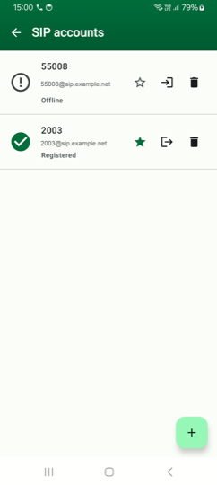 | 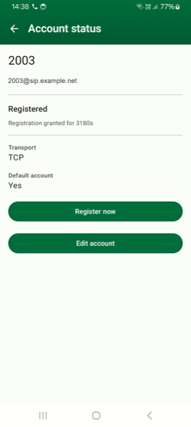 |

* **SIP accounts** — the app registers more than one at a time and shows each one's real
  state: `2003` **Registered** (green tick), `55008` **Offline** (warning). The filled star
  marks the default — the account a call leaves on unless the dialler says otherwise. Per
  row: register/unregister and delete. The FAB adds one.
* **Account status** — what the registrar actually granted, not what was asked for:
  **Registration granted for 3180s**, **Transport TCP**, **Default account Yes**. A wrong
  password reads *"Authentication failed"* and no network reads *"Offline"* — never a
  generic error, and never an optimistic "Registered" over a transport that is down (§6).

> **The one screen with no screenshot is the account editor**, and that is the feature
> working. [`AccountEditorScreen`](feature/accounts/src/main/kotlin/com/whatsappv2/feature/accounts/editor/AccountEditorScreen.kt)
> calls `SecureScreen()` (Tasks 21, 63) because it is the one place a SIP password is
> typed; `FLAG_SECURE` is scoped to it rather than set on the Activity, so the dialler and
> the call log stay capturable — *a user who cannot screenshot a call log cannot send a
> support request.* `adb screencap` returns an empty frame there.

### Settings

| Accounts, appearance, DTMF | Video, voice, transfer | Privacy, retention, version |
|---|---|---|
| 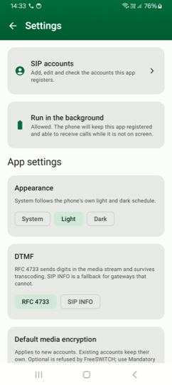 | 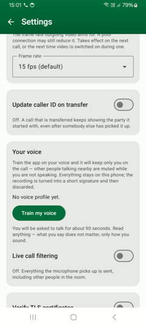 | 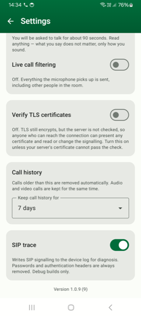 |

* **Top** — *SIP accounts*, and *Run in the background* reporting the battery-optimisation
  grant in plain words rather than a toggle whose state means nothing. Then **Appearance**
  (System / Light / Dark), **DTMF** (RFC 4733 or SIP INFO) and **Default media encryption**,
  each with the reason under it.
* **Middle** — **Frame rate** (`15 fps (default)`), which reaches the encoder and not just
  the policy, and takes effect at the next stream boundary because pjmedia cannot
  reconfigure a running video stream. **Update caller ID on transfer** is off by default:
  it needs the endpoint to advertise `X-FS-Support` first. **Your voice** trains a personal
  speaker gate — the signature stays on the phone and the recording is discarded.
* **Bottom** — **Live call filtering** ships **off** (it is the voice gate, and it is
  honest about what off means: *"Everything the microphone picks up is sent"*).
  **Verify TLS certificates** is off by default and says exactly what that costs.
  **Call history** retention is set to 7 days here. **SIP trace** writes signalling to logcat with
  passwords and authentication headers removed, debug builds only — and the build's
  identity sits at the very bottom: **Version 1.0.9 (9)**.

### Chat and recordings

| Chat sign-in | Call recordings |
|---|---|
| 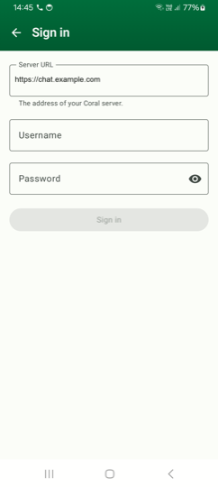 | 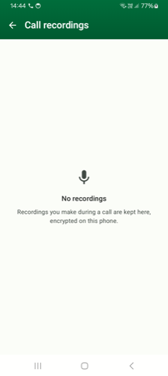 |

* **Chat sign-in** — reached from the Chats tab rather than from Settings, because the
  server URL belongs beside the credentials it is for. **Sign in** stays disabled while
  the credentials are empty.
* **Call recordings** — the empty state, and it states the guarantee it is making:
  *"Recordings you make during a call are kept here, encrypted on this phone."*

### Reproducing these

```bash
./launch.sh                    # build, install on the phone on USB, open the app
adb exec-out screencap -p > shot.png
```

`adb shell uiautomator dump /sdcard/ui.xml` gives the on-screen bounds to tap, which is
more reliable than reading coordinates off a screenshot. The account editor will return an
empty file — see above.

## Documents

| Document | Purpose |
|---|---|
| [`docs/android-sip-app-prompt.md`](docs/android-sip-app-prompt.md) | The requirements specification |
| [`docs/architecture.md`](docs/architecture.md) | HLD — decision record, module graph, layers, threading, sequence diagrams |
| [`docs/pjsip-migration.md`](docs/pjsip-migration.md) | The PJSIP migration (ADR-006): verified pjsua2 API map, the three things that are not a translation, tasks in order |
| [`docs/lld.md`](docs/lld.md) | LLD — the call FSM, the `SipEngine` contract and its error taxonomy, the Room schemas |
| [`docs/security.md`](docs/security.md) | Credentials at rest, transport and media security, logging policy, call recording |
| [`docs/testing.md`](docs/testing.md) | Unit, instrumented and server-backed suites, and how to point them at a server |
| [`docs/dod-sweep.md`](docs/dod-sweep.md) | Every Definition-of-Done item with its actual measured result |
| [`docs/calling.md`](docs/calling.md) | How a call happens: the Telecom seam, notifications, audio and push |
| [`docs/latency-sweep.md`](docs/latency-sweep.md) | Every screen classified pushed vs pulled, every timer named, six defects and their fixes |
| [`docs/data-structures.md`](docs/data-structures.md) | DSA dossier — every structure with its complexity bound, its capacity, its policy at that bound, and the failure it prevents |
| [`docs/module-structure.md`](docs/module-structure.md) | The module graph, package and visibility conventions, and the twelve machine-checked architecture rules |
| [`docs/system-design.md`](docs/system-design.md) | Beyond the APK — topology, capacity arithmetic, failure domains, observability, rollout |
| [`docs/native-dependencies.md`](docs/native-dependencies.md) | Every vendored native dependency: version, commit, licence, reason, patches, measured size — plus the pinned toolchain |
| [`docs/calling-completeness-prompt.md`](docs/calling-completeness-prompt.md) | The prompt for finishing the calling stack: two bugs traced to root cause, the codec gaps against what the server accepts, video's real blocker, and Lyra |
| [`docs/reconciliation.md`](docs/reconciliation.md) | Where the documents and the code disagree, with a citation and an owning phase for each |
| [`docs/lyra-recording-setup.md`](docs/lyra-recording-setup.md) | Server-side Lyra call recording: build, install, configure and verify, step by step (macOS + Linux) |
| [`docs/push-wake-architecture.md`](docs/push-wake-architecture.md) | How a call wakes a sleeping handset over FCM, and why it did not on the Coral deployment |
| [`docs/network-recovery.md`](docs/network-recovery.md) | What the client does when the network moves underneath it (Task 30, §6), with the log lines that prove it |
| [`docs/chat-sdk-integration.md`](docs/chat-sdk-integration.md) | Bringing `com.chatserver.sdk` in behind the Chats tab without changing a line of the SDK's Java |
| [`docs/ios-port.md`](docs/ios-port.md) | One repository, two platforms — the plan and the honest status of the iOS half |

## Server-side Lyra call recording

[`freeswitch-lyra/`](freeswitch-lyra/) adds **server-side recording of Lyra-to-Lyra calls**
to FreeSWITCH, as two C++ modules built against the installed server and the same
`third_party/lyra` closure the app uses:

* **`mod_lyra`** — a FreeSWITCH codec module wrapping Google Lyra v1.3.2, so the server can
  decode/encode `lyra/16000` (a codec it otherwise strips).
* **`mod_lyra_record`** — the recording policy: it drives FreeSWITCH's own recording engine
  to write a stereo WAV per call. Controlled entirely by `lyra_recording.conf.xml`;
  `enabled=false` (the default) changes nothing about a call.

The correction that shaped it: Lyra calls run with `bypass_media=true`, so the server never
sees the audio — recording therefore also takes a small, recording-only dialplan change to
keep FreeSWITCH in the media path. The design, failure/security review and a real
SIP/RTP integration test live under [`freeswitch-lyra/docs/`](freeswitch-lyra/docs/); the
step-by-step operator guide is [`docs/lyra-recording-setup.md`](docs/lyra-recording-setup.md).

## Build policy — CI checks the JVM half; the native half is built here

**The split, and the reason for it.** The native stage is a ~3 minute cross-compile *per
ABI* on top of the Lyra closure's ~25 minute TensorFlow Lite build, and it needs a 1 GB
NDK download before either can start. Nothing a unit test, a detekt rule or an
architecture assertion looks at can reach it — so paying for it on every push bought
nothing. CI now runs the JVM half (`./gradlew check -Ppjsip.native=false`) and the
cross-compile happens on the machine that needs the APK.

**CI still decides, for what it checks.** Push to `main` or open a PR and the **CI**
workflow runs two jobs: `guards` (vendored-tree integrity, the security and logging
assertions — about a minute) and `build` (compile, unit tests, detekt, lint, the
architecture rules and coverage thresholds). **Native mandate** runs its file-reading
provenance checks on the same pushes. Nothing is "done" until those are green. The Gradle
wrapper binary is generated by the **Bootstrap Gradle wrapper** workflow (run once,
manually), because a `.jar` cannot be authored by hand.

**What moved off the push path, and where it went instead:**

| Check | Now runs |
|---|---|
| The native cross-compile with egress blocked (N-2) | **Native mandate** → weekly, and on demand before a release |
| Every ABI carries `libpjsua2.so` and `libc++_shared.so` (N-6) | `./tools/release.sh`, on the APK it is about to publish |
| R8 ran and produced a mapping (Task 64) | `./tools/release.sh`, same run |

**Build locally, because CI cannot see everything.** A local run on macOS found five
defects an Ubuntu runner is structurally incapable of finding — the sharpest being that
Opus **downloaded a model from the network on every build** (`autogen.sh` → `wget`), which
defeats the offline mandate outright and passed silently on CI because every runner has
`wget`. `docs/native-dependencies.md` §1.3 has the full list.

### Building it yourself

```bash
./build.sh            # arm64-v8a debug APK, native stack compiled from source
./build.sh --help     # ABIs, --install, and what to do when swig is incomplete
./launch.sh           # build for the phone on USB, install or update it there, open the app
./launch.sh --help    # --no-build, --rebuild-native, --reinstall, --serial
```

### Cutting a release

A release is one command from a clean checkout:

```bash
./release.sh              # 1.0.9 -> 1.0.10: bump, commit, push, CI, arm64-v8a APK, publish
./release.sh --help       # --minor, --major, --version, --all-abis, --reuse-native, --dry-run
```

It bumps `versionCode` and `versionName` in `app/build.gradle.kts` and commits that, pushes
the branch, opens the draft release with generated notes, runs `tools/release.sh` to build,
check and upload the APK, and publishes only once CI is green for the pushed commit —
dispatching CI itself on a branch other than `main`, where nothing else would. It releases
from whatever branch you are on and says which; `--dry-run` prints the plan and changes
nothing.

The two halves still work on their own. When a merge that bumped the version lands on
`main`, the **Release** workflow tags `v$versionName` and opens a **draft** release with
notes generated from the commits since the last tag (a merge that does not change the
version cuts no release, and says so rather than failing). That draft has no APK in it,
because CI cannot build one that can place a call; finish it from a checkout of that
commit:

```bash
git checkout main && git pull
./tools/release.sh        # build all three ABIs, check, upload, publish
./tools/release.sh --help # --reuse-native, --abi, --no-publish, --skip-r8
```

That builds the APK, asserts it carries the SIP stack for every ABI it packages, builds
the minified release variant so R8 is still gated, uploads the APK and `mapping.txt`, and
publishes the draft. It prints the signing certificate as it goes: a debug APK built here
is signed with **this machine's** debug keystore, and Android refuses to install one over
an APK signed by a different key — so a build from a different machine needs an
`adb uninstall` first.

It finds the NDK, checks the two toolchain preconditions whose Gradle-level errors read as
something else entirely, prints the APK's path and lists the native libraries actually
inside it. The long form, and what it is doing:

```bash
export JAVA_HOME=/path/to/jdk-21
export ANDROID_HOME="$HOME/Library/Android/sdk"      # or wherever your SDK lives

# The fast half: compiles, unit tests, detekt, the architecture rules. ~1 minute warm.
./gradlew :domain:test :data:sip:testDebugUnitTest :test:arch:test :test:arch:detekt \
  -Ppjsip.native=false

# The whole thing, including the native stack. ~20 min for one ABI from cold.
export ANDROID_NDK_ROOT="$ANDROID_HOME/ndk/android-ndk-r27c"
./gradlew :app:assembleDebug -Ppjsip.abis=arm64-v8a
```

**Three properties exist for local work, and none of them weakens a rule:**

| Property | What it does | Why it is safe |
|---|---|---|
| `-Ppjsip.abis=arm64-v8a` | Builds one ABI instead of three | ~20 min instead of ~60. `./tools/release.sh` passes no override, so the APK a release ships is checked for all three, and it warns when it is not. A one-ABI APK simply will not install elsewhere — loud, not silent |
| `-Ppjsip.native=false` | Skips the native stage entirely | Produces **no** `.so` and therefore **no APK** — `assertNativeLibraries` fails packaging. This is not the fallback N-14 deleted; that one quietly shipped an APK that died on the first call |
| `-Ppjsip.swig=/path/to/swig` | Points at a specific SWIG | The build pins **4.2.0** and asserts it. Some distributions ship a different version, or split the Java typemaps into a separate package — see below |

### What you need installed

| | | |
|---|---|---|
| JDK 21 | runs Gradle | |
| Android SDK, `android-37` | | `compileSdk` |
| **NDK r27c** (`27.2.12479018`) | native stage only | **r27+ is mandatory** — 16 KB page alignment, which Play requires for Android 15+ |
| **SWIG 4.2.0** | stage 1, the bindings | Pinned, and the pin is enforced |

**Two traps worth knowing before you hit them:**

**SWIG is split by target language on some distributions.** MacPorts' `swig` has no `java/`
typemaps, and SWIG's own error names five files nobody wrote (`arrays_java.i`,
`enumtypeunsafe.swg`, …) as though the source tree were corrupt. The build checks for this
and tells you to `port install swig-java`. Debian's `swig` package is monolithic and fine.

**Android Studio's Gradle daemon holds `.gradle/noVersion/buildLogic.lock`.** A command-line
build then dies with *"Timeout waiting to lock build logic queue"* after seven minutes. Kill
the daemon — it is launched with Studio's bundled JRE and is **not** the IDE, so nothing in
your editor is affected and Studio starts a fresh one on the next sync.

## Toolchain

| Component | Version | Pinned in |
|---|---|---|
| Gradle | 9.7.1 | `gradle/wrapper/gradle-wrapper.properties` |
| JDK (runs Gradle) | 21 | `.github/workflows/ci.yml` |
| JVM toolchain (bytecode target) | 17 | `gradle/libs.versions.toml` |
| Android Gradle Plugin | 9.4.0 | `gradle/libs.versions.toml` |
| Kotlin | 2.4.10 | `gradle/libs.versions.toml` |
| **Android NDK** | **r27c** (`27.2.12479018`) | `.github/workflows/native-mandate.yml` and `build-pjsip.yml`, and **asserted** at build time |
| **SWIG** | **4.2.0** | `pjsip/api/build.gradle.kts`, and **asserted** at build time |
| minSdk | 26 | `gradle/libs.versions.toml` |
| compileSdk / targetSdk | 37 | `gradle/libs.versions.toml` |

Versions are pinned from the **bootstrap workflow's version report**, which queries
Google Maven, Maven Central and services.gradle.org — not from memory.

Every version lives in the version catalog. No version literal belongs in a
`build.gradle.kts` — CI fails the build if one appears.

## Status

All 68 tasks implemented. What is **verified** is narrower than what is built, and the
difference is written down rather than smoothed over: see
[`docs/dod-sweep.md`](docs/dod-sweep.md) for every Definition-of-Done item with its actual
result. The per-task `Done when` detail lives in the task plans, which are kept out of
this repository as working notes.

The short version: everything decidable without hardware is covered by the JVM suite and
gated in CI. Everything that needs a handset or a reachable SIP server — video on a real
camera, a transfer between three endpoints, a conference of three clients, battery over an
hour — is implemented and **not** verified, because this project has never had a device or
a reachable target in CI. Those boxes are left unticked.

## Getting to a registered call

The whole path, for somebody who has just cloned this.

### 1. Build

Nothing to install. Push a branch or open a PR and the **CI** workflow builds, tests and
publishes a debug APK as a run artifact. To build locally instead you need JDK 21 and the
Android SDK, then `./gradlew :app:assembleDebug`.

### 2. Point it at a SIP server

Nothing about a server is committed — a host is a LAN address that changes with the
network and a password is a credential, and either in git is a leak that outlives the
commit that removed it. A CI step fails the build if they reappear.

Put them in `~/.gradle/gradle.properties`, outside the repository:

```properties
sip.test.host=192.168.1.10
sip.test.domain=192.168.1.10
sip.test.port=5060
sip.test.extension=1018
sip.test.extension.secondary=1019
sip.test.password=your-extension-password
sip.test.conference=3000
```

These configure the **instrumented** suite. To use the app by hand, install it and add an
account through the UI — Accounts → Add — which needs the same host, extension and
password and nothing else.

Full detail, including which extensions are reserved for automation:
[`docs/testing.md`](docs/testing.md).

### 3. Register and call

Add an account, wait for the row to read **Registered**, then dial an extension on the
same server from the keypad. If the row does not reach Registered it says why: a wrong
password reads "Authentication failed" and no network reads "Offline" — never a generic
error, and never an optimistic "Registered" over a transport that is down (§6).

## Configuration

| What | Required for | Supplied how |
|---|---|---|
| SIP host, extension, password | the instrumented suite | Gradle properties or CI secrets — never committed |
| A SIP account | using the app at all | entered in the UI; stored AES-GCM encrypted under a Keystore key |
| `google-services.json` | the push wake path | **not committed and not required.** Drop it at `app/google-services.json` (gitignored) and the build emits the Firebase resources itself — no plugin. Without it the app builds and runs with no push; `PushTokenPublisher` logs that rather than hiding it |
| An ESL push gateway | calls arriving while the app is asleep | `coralx-push-sender/` (Go, in this repository), deployed next to FreeSWITCH (ADR-004) |
| A release keystore | a signed APK | held by the release pipeline. `assembleRelease` here produces an **unsigned** APK on purpose — a keystore in git is a compromised keystore |

## Build variants

| Variant | Minified | Logging | Extras |
|---|---|---|---|
| `debug` | no | verbose and up | LeakCanary; the SIP trace toggle in Settings |
| `release` | R8 full mode, resources shrunk | **warn and error only**, by construction | mapping file archived by CI |

The release logger's `verbose`, `debug` and `info` have empty bodies rather than a runtime
level check, so R8 removes the call sites entirely and the strings never reach the binary
(§7, DoD 12). A CI step fails the build if that stops being true.
