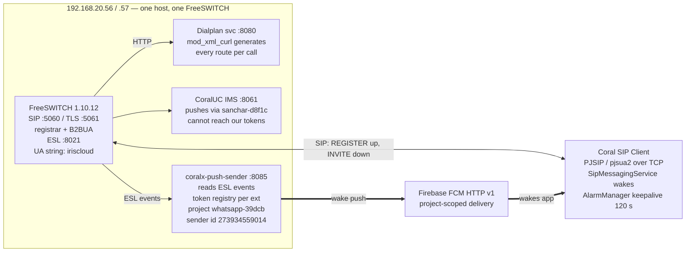
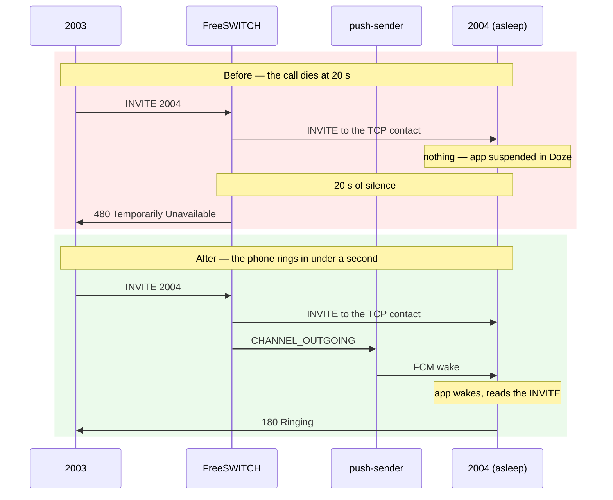

# Push wake: architecture and fix

As of 2026-10-17.

A call from 2003 to 2004 never rang the callee, and the cause was not a bug in any
component — it was that **nothing on the server ever asked FCM to wake the phone**. The
push gateway had been running on 192.168.20.56 since 15 October and had sent exactly zero
pushes in its entire log history.

## The problem

What the wire showed, captured with sngrep on a real failing call:

```
12:24:34.692  INVITE sip:2004@192.168.103.128:46587;transport=TCP  →  (device)
       +0.20  100 Trying
      +19.99  480 Temporarily Unavailable
       +0.00  ACK
```

The INVITE is well-formed and correctly addressed — it even carries the RFC 8599 push
parameters the device registered with. It is written into a TCP socket belonging to a
handset asleep in Doze, and twenty seconds later the switch gives up. Nothing reports an
error, because from SIP's point of view nothing failed: the registration row is valid, the
contact is current, the socket reads ESTABLISHED.

The tell was in the workaround. Manually re-registering 2004 at the moment of the call
made it ring every time — because opening the app to register is what woke the handset.
The registration was never the problem. Being asleep was.

## The moving parts



`192.168.20.56` and `192.168.20.57` are **the same machine and the same FreeSWITCH** — the
`internal` profile binds `.57` and `.56` is an alias for it. A capture showing an INVITE
travelling from `.57` to `.56` is the switch talking to itself across its own alias, not
two boxes. That matters: it means a real channel exists for that leg, which is what the fix
hooks.

Two components can push, and only one can succeed:

| Component | Firebase project | Can it wake our handsets? |
| --- | --- | --- |
| CoralUC IMS, `:8061` (Java) | `sanchar-d8f1c` | **No** — FCM HTTP v1 is project-scoped |
| `coralx-push-sender`, `:8085` (Go) | `whatsapp-39dcb` | Yes |

FCM tokens are minted under one project and can only be delivered to by a server holding
that project's key. Our tokens come from `whatsapp-39dcb` (sender id `273934559014`). The
Java IMS holds a `sanchar-d8f1c` key, so no configuration on that side will ever ring this
app. That is the `480` in the capture.

The gateway also shares the SIP domain with another product: extension 4038 registers from
`CoralUCAPP` carrying `pn-param=58415781151`. The `-fcm-sender-id` flag makes the registry
store only tokens minted under our own sender id.

## Why the original design could never fire

ADR-004 assumed the dialplan is static XML a file can be added to. Here it is not.

`mod_xml_curl` is bound for the dialplan:

```xml
<binding name="dialplan">
  <param name="gateway-url" value="http://127.0.0.1:8080/dialplan" bindings="dialplan"/>
</binding>
```

Every routing decision for a user extension is generated per call over HTTP by the Coral
application. The static `dialplan/default/*.xml` include exists — at `default.xml:815`,
ahead of the two `^(.*)$` catch-alls — but is never reached for an extension. A file
dropped into `dialplan/default/` fires nothing. This is also why 2003 and 2004 appear
nowhere in the static config, and why `Local_Extension` only matches `^(10[01][0-9])$`.

The generated dialplan can be read directly:

```
curl -XPOST 127.0.0.1:8080/dialplan \
  -d section=dialplan -d key_value=default \
  -d Caller-Destination-Number=2004
```

It returns about sixty actions and ends:

```xml
<action application="bridge" data="{alert_info=alert-external}user/2004"/>
<action application="transfer" data="2004 XML NOTALK"/>
```

with `call_timeout=30`, `continue_on_fail=true`, and **no push hook of any kind**.

That ruled out park-and-resume entirely: without a dialplan we control there is no park to
hold the caller and no resume context to bridge into, and transferring a live channel into
a context that does not exist would end the call rather than rescue it.

What it does give us is the budget: `call_timeout=30` means thirty seconds of room.

## The call flow, before and after



The push does not replace or delay anything. FreeSWITCH still sends the INVITE at exactly
the moment it always did; the gateway sees the same channel being created and sends a wake
in parallel. If the device was awake, the push is redundant and harmless.

## The fix: trigger on the leg, not on the dialplan

The wake fires on `CHANNEL_OUTGOING`. The event was captured on a real leg before anything
was written against it, so the header names are observed rather than assumed:

```
Event-Name: CHANNEL_OUTGOING
Call-Direction: outbound
Caller-Destination-Number: 2004
Unique-ID: b66361b2-ac3a-4db1-9fdb-70bc1ddc6557
Channel-Name: sofia/internal/2004%40192.168.103.128%3A46587
```

Three design decisions matter more than the code:

**It keeps no call state.** No park to release, no resume context to bridge into. The
handler pushes and forgets; the generated dialplan keeps its own failure handling. Nothing
this service does can strand or misroute a channel. The park/resume machinery in `wake.go`
is untouched for deployments that do own their dialplan.

**The token registry is the filter.** A push only goes out if the destination has a token
under our sender id. A dozen other extensions are registered on this switch (4004, 4010,
4014, 4026, 7979, 2007…), plus another product on 4038. Trunks, gateways, conference legs
and foreign handsets all resolve to no token and are ignored.

**It is behind a flag, default off.** `-wake-on-outbound-leg` is set only where the
dialplan cannot announce a call itself.

One channel fires `CHANNEL_OUTGOING`, `CHANNEL_CREATE` and `CHANNEL_ORIGINATE` within
microseconds, so a per-channel note suppresses duplicates for a minute.

## The trap that cost a deployment

The first version of this fix installed cleanly, reported `wake_on_outbound_leg=true`, and
did nothing. `Subscribe` joins every event name onto one ESL command line:

```
event json CHANNEL_PARK CHANNEL_HANGUP_COMPLETE CUSTOM sofia::register coralx::push_wake CHANNEL_OUTGOING
```

FreeSWITCH treats **every token after `CUSTOM` as a custom subclass**. `CHANNEL_OUTGOING`
was appended at the end, so it registered as a subclass that does not exist. The
subscription still returns `+OK`. No warning, no error — the service looks healthy and the
event never arrives.

Order is load-bearing, so the list is split by kind and the ordering asserted:

```go
var (
    standardEvents = []string{"CHANNEL_PARK", "CHANNEL_HANGUP_COMPLETE"}
    customEvents   = []string{"CUSTOM", "sofia::register", "coralx::push_wake"}
)

func eventsFor(cfg config) []string {
    events := append([]string{}, standardEvents...)
    if cfg.wakeOnOutboundLeg {
        events = append(events, "CHANNEL_OUTGOING")
    }
    return append(events, customEvents...)
}
```

**A subscription that returns `+OK` is not evidence that the event will arrive.** The only
proof is seeing the event handled.

## Where the code lives

| File | What it does |
| --- | --- |
| `coralx-push-sender/internal/wake/outbound.go` | **New.** `OnOutboundLeg` — the trigger. Looks up the token, dedupes per channel, pushes and forgets. |
| `coralx-push-sender/internal/wake/wake.go` | Adds the `legs` dedupe map and sweeps it. |
| `coralx-push-sender/cmd/push-sender/main.go` | The flag, the corrected `eventsFor` ordering, the dispatch case, the startup log. |
| `coralx-push-sender/cmd/push-sender/main_test.go` | **New.** Four tests pinning the subscription order. |
| `coralx-push-sender/internal/wake/outbound_test.go` | **New.** Seven tests covering the trigger. |
| `coralx-push-sender/internal/registry/registry.go` | `WithSenderID` — the FCM project isolation, enforced at `Observe`. |
| `data/sip/.../network/RegistrationRecoveryCoordinator.kt` | `KEEPALIVE_CEILING` — caps the lease refresh at 120 s. |
| `data/sip/.../stack/RealPjsipCoreGateway.kt` | `USER_AGENT` — the announced product token. |

### The Android keepalive ceiling

The lease refresh is capped at 120 s, where it previously used half the granted lease. A
registrar granting 5180 s armed the keepalive at 2590 s, and calls stopped arriving within
ten minutes of the last REGISTER — the NAT mapping behind the contact expires long before
the lease does.

Two caveats:

- `AlarmWakeTimer` uses `setExactAndAllowWhileIdle`, which the platform throttles to
  roughly one firing per 9–15 minutes in Doze for apps not exempt from battery
  optimisation. The reference handsets are allow-listed; an ordinary user's device
  degrades silently.
- The 120 s figure comes from RFC 5626 §4.4.1, which covers connection-oriented flows. UDP
  NAT mappings are routinely much shorter. These accounts are on TCP, so it fits — but the
  number is transport-specific.

### User-Agent and mesh recognition

`USER_AGENT` is now `coraluc-v2`. `CORALX_AGENT_TOKEN` stays `coraluc` deliberately:
`isCoralxAgent` matches a peer's User-Agent by **substring**, so the rule is "the
announcement must contain the token", not "the two must be equal". `coraluc-v2` contains
`coraluc`, so a v2 build and a build already in the field still recognise each other and
still mesh. Moving the token with it would have stranded every installed copy, and those
calls would have silently relayed through the host — four channels where six belong, with
no symptom beyond the channel count.

## What was measured

Every number taken on the live switch on 17 October.

| Measurement | Result |
| --- | --- |
| Manual `/push` → REGISTER | 923 ms |
| Trigger → FCM accepted (run 1) | 692 ms |
| Trigger → REGISTER (run 1) | 944 ms |
| Trigger → FCM accepted (run 2) | 181 ms |
| Trigger → REGISTER (run 2) | 461 ms |
| Switch timeout before `480` | 20 s |

The first measurement came before any code was written and reframed the problem: a manual
push to 2004 returned `{"sent":true}` and the REGISTER landed 923 ms later, off the 120 s
keepalive cadence, so unmistakably push-triggered. That proved the client wake path, the
token registry and the Firebase project were all already correct.

The fix working end to end:

```
12:34:25.160  outbound leg to a push device: sending FCM   ext=2004 token=…le5sDvTQ
12:34:25.341  outbound leg: FCM accepted                   ext=2004
12:34:25.621  REGISTER with push token                     user=2004  agent=coraluc
```

Against a 20 s window, a sub-second wake leaves roughly a twentyfold margin.

## What is not yet proven

Every test so far hit a handset woken minutes earlier. They prove the **trigger** works.
They do not prove the fix rescues a call to a handset that was genuinely asleep.

The open question is what Android did with the TCP socket while the app was suspended:

- **If the socket survived** — the INVITE sits in the receive buffer, PJSIP reads it on
  waking, the phone rings. The fix is complete.
- **If the socket was torn down** — the INVITE is gone. The device wakes and re-registers
  on a *new* socket, but nothing re-sends the INVITE. The phone stays silent.

If the second case holds, the follow-on is to re-ring the caller's leg once the REGISTER
lands — a `uuid_transfer` of the A-leg back through the dialplan, re-bridging against the
fresh registration while the caller still hears ringback. Note `CHANNEL_OUTGOING` carries
**no** `Other-Leg-Unique-ID` (the leg predates the bridge link), so that path must hook a
later event to find the A-leg.

The test that settles it: leave 2004 untouched for ~10 minutes, follow
`journalctl -u coralx-push-sender -f`, and place a real call from 2003.

## Operating it

The host is `apprimary` (`support@192.168.20.56`, key-based; `sudo` needs a password).
FreeSWITCH is **not** at `/etc/freeswitch` — it is `/etc/coraltele/sipserver/{conf,bin}`:

```
/etc/coraltele/sipserver/bin/fs_cli -H 127.0.0.1 -P 8021 -p ClueCon
```

The gateway runs as `coralxpush` from `/opt/coralx-push-sender/push-sender`, unit
`coralx-push-sender.service`, state in `/var/lib/coralx-push-sender` (not readable as
`support` — use the HTTP API).

### Is it healthy?

```
curl -s 127.0.0.1:8085/healthz
curl -s 127.0.0.1:8085/tokens
```

`healthz` should show `"esl":true`, `"fcm":true` and the project. `tokens` lists which
extensions can be woken — an extension missing from it will never be pushed.

### Is the fix on?

```
FCM configured project=whatsapp-39dcb sender_id=273934559014 wake_on_outbound_leg=true
```

All three fields matter. `sender_id` empty means any project's tokens are accepted;
`wake_on_outbound_leg=false` means no call will ever produce a push.

### Deploying

```
cp -a /opt/coralx-push-sender/push-sender /opt/coralx-push-sender/push-sender.bak-$(date +%Y%m%d-%H%M%S)
install -o root -g root -m 0755 /tmp/push-sender-new /opt/coralx-push-sender/push-sender
systemctl restart coralx-push-sender
journalctl -u coralx-push-sender -n 8 --no-pager
```

Rollback is the backup copied back and a restart. Verify the checksum before installing.

### Testing without a handset

1. `curl -XPOST 127.0.0.1:8085/push -d '{"account_id":"2004"}'` — one wake, no call.
   Proves FCM delivery alone.
2. `fs_cli -x "bgapi originate user/2004 &park"` — the real `sofia/internal/...` leg.
   Proves the trigger.

Do **not** use `originate loopback/2004/default` as a stand-in: with no caller IP the
generated dialplan takes a `denyacl` path. And never use `hupall` on this switch — it
hangs up every call on the box, including other users'.

### Reading the log

A working call produces three lines in order:

```
outbound leg to a push device: sending FCM   uuid=... ext=2004 token=...
outbound leg: FCM accepted                   uuid=... ext=2004
REGISTER with push token                     user=2004 ... agent=coraluc-v2
```

- **No first line** → the trigger did not fire: flag off, no token, or event not subscribed.
- **First but not second** → FCM rejected it. `FCM says the token is dead` means the token
  was dropped and the handset must re-register.
- **All three but no ring** → the open case above.

Steady-state noise is healthy: a `REGISTER with push token` per extension every 120 s, and
periodic `REGISTER carries a push token from another FCM project; ignoring` for 4038.
